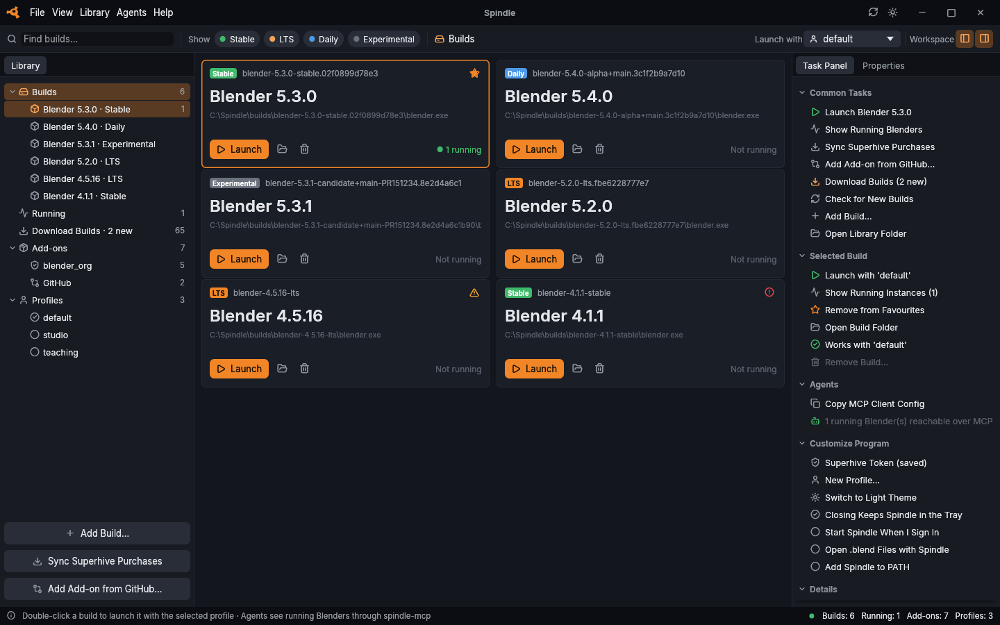
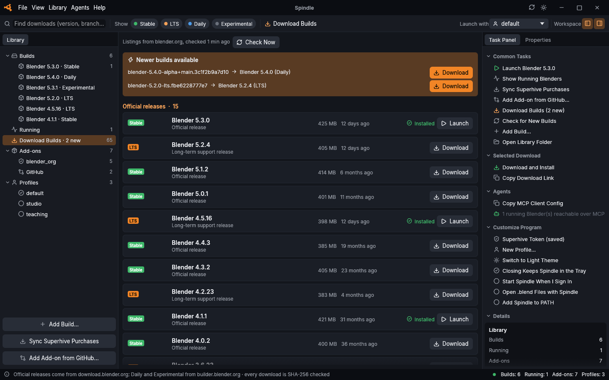
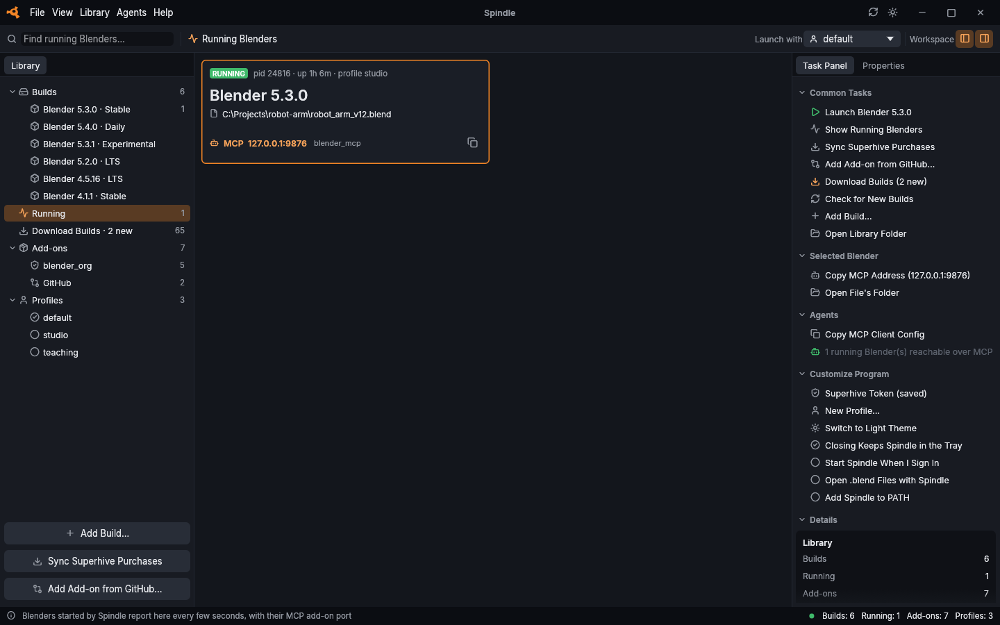
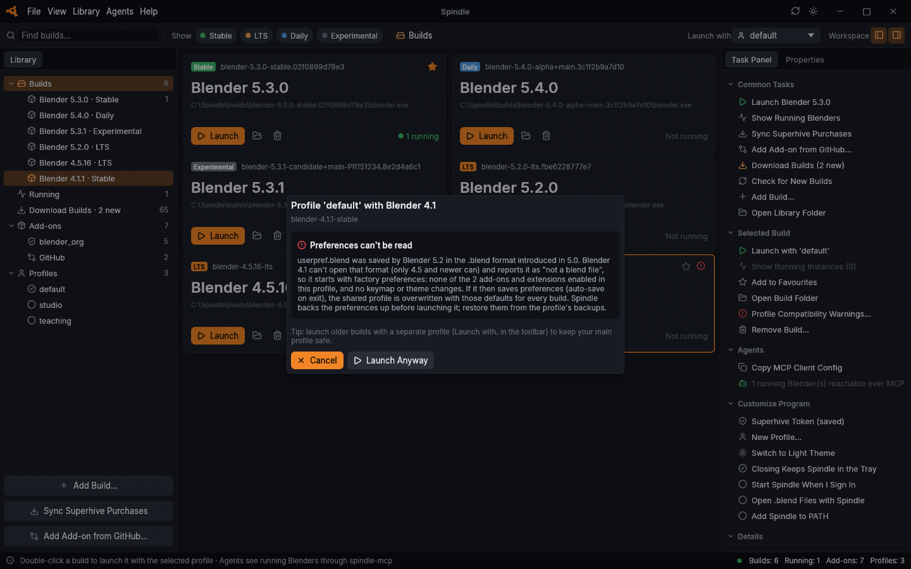
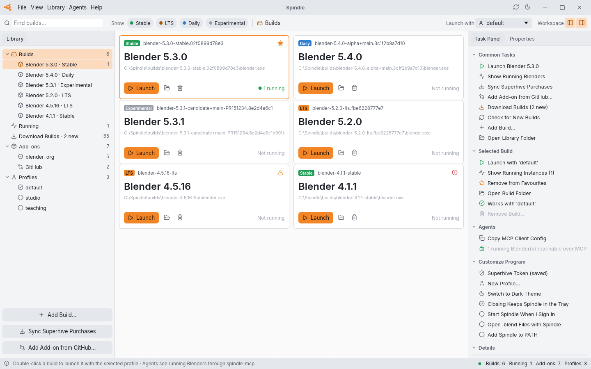
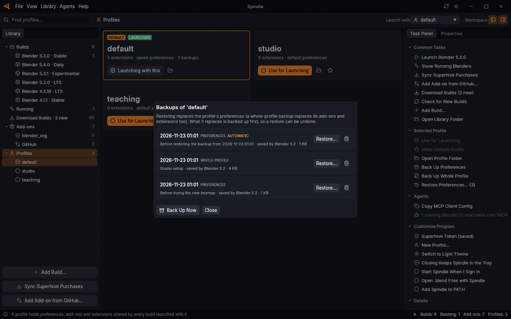
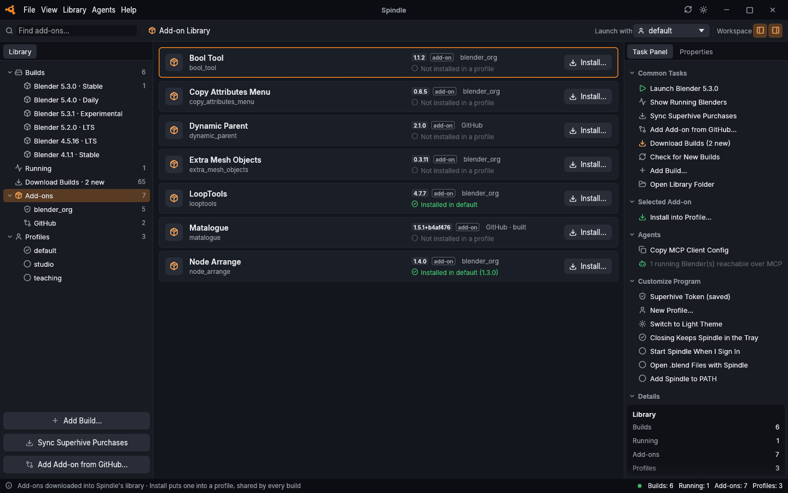
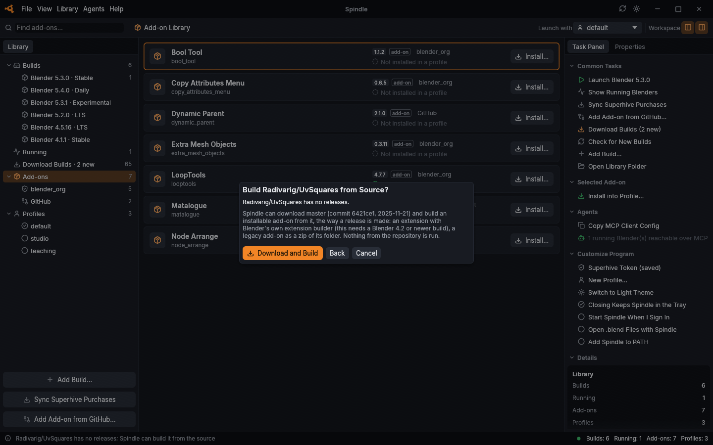

<p align="center">
  
</p>

<p align="center">
  <b>One place for all your Blender builds, one profile for all of them.</b><br>
  Download releases and daily builds, launch any of them with the same preferences and add-ons,<br>
  and let your agents see the Blender that's actually running.
</p>

<p align="center">
  <a href="https://github.com/deepfold9118/spindle/releases/latest"></a>
  <a href="https://github.com/deepfold9118/spindle/actions/workflows/ci.yml"></a>
  <a href="LICENSE"></a>
  
</p>

<p align="center">
  
</p>

## Why Spindle

Portable Blender builds are great until every one of them has its own preferences, add-ons
need reinstalling for each new daily, and an agent asking "which Blender is open?" can't tell.
Spindle keeps a library of builds, launches every one of them onto a shared profile, checks
first when an older build would trip over newer preferences, and reports the running Blenders
(and their MCP add-on ports) to agents.

## Features

<table>
<tr>
<td width="50%" valign="top">

**Download builds**<br>
Official Stable and LTS releases from download.blender.org, and Daily, experimental-branch
and patch (PR) builds from builder.blender.org. Every download is checked against its
published SHA-256 before it's unpacked.

</td>
<td width="50%" valign="top">

**Shared profiles**<br>
Every build launches with `BLENDER_USER_RESOURCES` pointing at a Spindle profile: the same
preferences, add-ons and extensions in old builds and in the daily you downloaded a minute ago.
Nothing is copied per build.

</td>
</tr>
<tr>
<td valign="top">

**Profile compatibility checks**<br>
Before an older build opens a profile, Spindle says exactly what will break and why: unreadable
5.0+ preferences, extensions outside their Blender range, wheels for another Python, and more.

</td>
<td valign="top">

**Opens .blend files in the right build**<br>
Register Spindle for `.blend` files and each one opens in the build of the Blender that saved
it, read from the file header (zstd and gzip compressed files too).

</td>
</tr>
<tr>
<td valign="top">

**Running Blenders for agents**<br>
A bridge script reports every running Blender, its open file and its MCP add-on's host and
port. `spindle-mcp` serves that to any MCP client, and can launch builds.

</td>
<td valign="top">

**New-build alerts, tray, favourites**<br>
Spindle checks for newer builds every six hours and stays in the tray (Windows, Linux, macOS)
to launch builds. Star favourites; the first one is the default. It can update itself, too.

</td>
</tr>
</table>

**Preference backups**: back up a profile's preferences (or the whole profile, add-ons
included) and restore any backup later. Spindle backs the preferences up by itself before an
older Blender opens them, and every restore backs up what it replaces first.

**Add-ons from GitHub**: paste a repository link and Spindle downloads the add-on from its
newest release, checked against the SHA-256 GitHub publishes. When there's no release to
download, it offers to build one from the source. Superhive purchases download into the same
add-on library (the API token stays in the OS credential store). Install puts an add-on into a
profile, so every build launched with that profile has it, and the library shows which profiles
each add-on is in, at which version, and whether it's switched on.

## Screenshots

| Download builds | Running Blenders and their MCP ports |
|---|---|
|  |  |
| **Profile compatibility check** | **Light theme** |
|  |  |
| **Preference backups** | **Add-on library** |
|  |  |

## Install

**Windows** (PowerShell):

```powershell
& ([scriptblock]::Create((irm https://github.com/deepfold9118/spindle/releases/latest/download/install.ps1)))
```

**Linux and macOS**:

```sh
curl -fsSL https://github.com/deepfold9118/spindle/releases/latest/download/install.sh | sh
```

The installer downloads the latest release, checks it against the release's `SHA256SUMS`,
installs it for you alone (no administrator rights) and starts Spindle:

| | Windows | Linux / macOS |
|---|---|---|
| Programs | `%LOCALAPPDATA%\Programs\Spindle` | `~/.local/share/spindle` |
| Shortcut | Start menu | application menu (Linux) |
| PATH | the folder is added to your user `Path` | links in `~/.local/bin` |
| Options | `-StartAtSignIn` `-OpenBlendFiles` `-NoPath` `-Dir <folder>` | `--start-at-sign-in` `--no-path` `--dir <folder>` |
| Uninstall | `& "$env:LOCALAPPDATA\Programs\Spindle\install.ps1" -Uninstall` | `sh ~/.local/share/spindle/install.sh --uninstall` |

Running the installer again upgrades in place, and so does **Help > Spindle Updates** in the app
(or `spindle self-update`). Uninstalling removes the programs, shortcut, PATH entry and
registrations; your library, profiles and settings stay. Each release archive also carries the
installer, so `install.ps1` / `install.sh` from an unpacked archive installs that release
without downloading. Start at sign-in, opening `.blend` files and PATH can be switched later
under **Customize Program**, or with `spindle desktop`.

You can also just unpack an archive from the
[latest release](https://github.com/deepfold9118/spindle/releases/latest) anywhere and run
`spindle_app`. Each archive holds three programs:

| Program | What it is |
|---|---|
| `spindle_app` | the desktop app |
| `spindle` | the command line |
| `spindle-mcp` | the MCP server for agents (stdio) |

- **Windows** (`windows-x64.zip`): on first start Windows SmartScreen may ask, since the
  programs aren't signed. A new tray icon starts in the overflow (^) area; pin it under
  Settings > Personalization > Taskbar > Other system tray icons.
- **Linux** (`linux-x64.tar.gz`): the tray icon uses StatusNotifierItem (KDE, most desktops;
  GNOME needs the AppIndicator extension).
- **macOS** (`macos-arm64` / `macos-x64.tar.gz`): the programs aren't notarised, so clear the
  download quarantine once: `xattr -dr com.apple.quarantine <folder>`. Opening `.blend` files
  from Finder needs an app bundle, which isn't shipped yet; use `spindle open <file>`.

## Getting started

1. Start `spindle_app`. Pick a library folder with `spindle set-library <dir>` if you don't
   want the default (your platform's local data folder).
2. **Download Builds** (Ctrl+5): pick a release or a daily, or add a build you already have
   with **Add Build…**.
3. Launch it. The first launch sets up the `default` profile; every build you launch later uses
   the same one. Use **Launch with** in the toolbar for other profiles.
4. Optional, under **Customize Program**: start Spindle when you sign in, open `.blend`
   files with Spindle, and add Spindle to PATH.

## Agents (MCP)

```json
{ "mcpServers": { "spindle": { "command": "path/to/spindle-mcp" } } }
```

| Tool | Does |
|---|---|
| `list_running_blenders` | Blenders started by Spindle, their open file, profile and MCP add-on address |
| `list_builds` | the build library |
| `launch_blender` | start a build (or the build that suits a `file`) with a profile; refuses builds that can't read the profile unless `force` |

**Copy MCP Client Config** in the app puts the snippet above on the clipboard with the right path.

## Profile compatibility

Every build shares one profile, so a build older than the Blender that last saved it can meet
files it doesn't understand. `spindle check <build>` (and the app, before launching) reports:

| Check | Why it matters |
|---|---|
| `userpref.blend` in the 5.0+ .blend format, build older than 4.5 | **Blocker.** Blender reports "not a blend file" and starts with factory preferences; if it then saves preferences, the shared profile is overwritten with defaults. |
| Preferences saved by a newer Blender | Settings added after the build's version are ignored, and dropped if it saves preferences. |
| `startup.blend` in the 5.0+ format, build older than 4.5 | The factory startup scene opens instead. |
| Enabled extensions on a build older than 4.2 | The extensions platform doesn't exist there; each one is named. |
| `blender_version_min` / `blender_version_max` of enabled extensions | Blender refuses to load them; each one is named with the version it needs. |
| Extension wheels built for another Python | Bundled packages fail to import (the build's Python is read from its `python3XX` library). |
| Legacy add-ons whose `bl_info["blender"]` is newer than the build | Blender flags them and they may fail to register. |

Builds older than 3.6 ignore `BLENDER_USER_RESOURCES` (verified with 2.93), so Spindle also sets
`BLENDER_USER_CONFIG`, `BLENDER_USER_SCRIPTS` and `BLENDER_USER_DATAFILES` for them.
`spindle launch` and the MCP `launch_blender` tool refuse a blocker unless forced.

## Preference backups

A preferences backup is a zip of the profile's `config/` folder: `userpref.blend`,
`startup.blend`, bookmarks and recent files. A whole-profile backup adds the add-ons,
extensions and everything else in the profile. Backups live in the library's `backups/` folder.

- **By hand**: **Back Up Preferences** or **Back Up Whole Profile** in the Task Panel when a
  profile is selected, or `spindle profiles backup [<profile>] [--full] [--note "…"]`.
- **Automatically**: before any launch (app, tray, command line or MCP) where a build older than
  the Blender that saved the preferences opens them, unless they haven't changed since the last
  backup. The newest ten automatic backups of each profile are kept; ones made by hand stay
  until you remove them.
- **Restoring**: **Restore Preferences…** lists a profile's backups. A preferences backup
  replaces `config/`; a whole-profile backup replaces the whole profile. What it replaces is
  backed up first, so a restore can be undone the same way. Spindle won't restore while a
  Blender is running with the profile, since that Blender would save its own preferences over
  the restored ones on exit. `spindle profiles restore <backup> [--into <profile>]` restores
  from the command line, into another profile too.

When a `.blend` file is opened with Spindle it goes to a build of the series that saved it (a
favourite first), else the default build, else the oldest newer build, skipping builds the
profile blocks. A file newer than every build asks first.

## Add-ons from GitHub

<p align="center">
  
</p>

**Add Add-on from GitHub…** (Library menu, Task Panel, or the add-on library) and
`spindle addons github <link>` take a repository link: `https://github.com/owner/repo`,
`owner/repo`, a release (`…/releases/tag/v1.2`), or a branch, tag or commit and a folder
(`…/tree/main/my_addon`).

- **From a release**: the newest release (or the linked one) is searched for an asset that holds
  an add-on (a `.zip` with `blender_manifest.toml` or `bl_info`, or a single-file `.py`),
  preferring one named for your platform and skipping ones named for another. The download is
  checked against the SHA-256 GitHub lists for it.
- **Built from the source**: when there's no release, its release has no add-on archive, or the
  link names a branch or folder, Spindle says so and offers to build it (the command line asks,
  or builds straight away with `--build`). It downloads that exact commit, finds the add-on (the
  shallowest `blender_manifest.toml`, else a package or `.py` file with `bl_info`) and packages it
  the way a release is made: an extension with `blender --command extension build` from a
  Blender 4.2+ build in the library (factory settings, no profile touched), a legacy add-on as a
  zip under a valid module name (`Principled-Baker` installs as `Principled_Baker`). Built
  versions carry the commit, like `1.5.1+b4af476`. A repository holding several add-ons at the
  same depth needs a link to one folder; the error suggests it.
- **Nothing from the repository is run**, so add-ons that need a build step of their own
  (compiled code, generated files, wheels that aren't committed) can't be built this way.
- **Installing**: add-ons go into a profile, never into a build. Extensions go into the
  profile's `user_default` repository (Blender 4.2+); legacy add-ons go through Blender's add-on
  installer into the profile's `scripts/addons`. Either way they're enabled and the preferences
  are saved. You choose only the profile: Spindle runs Blender's installer with a library build
  that can install the add-on (4.2+ for an extension, inside the add-on's own Blender range),
  preferring the series that last saved the profile's preferences so they keep their format.
  It won't install while a Blender is running with the profile, since that Blender saves its
  own preferences when it quits and would switch the add-on off again.
- **Updating**: **Check GitHub for a Newer Version** on a GitHub add-on adds its link again,
  which picks up a newer release or commit.

GitHub requests are anonymous (60 an hour) unless `GITHUB_TOKEN` or `GH_TOKEN` is set, which
also reaches private repositories.

## Command line

```
spindle info
spindle builds list                     # * marks favourites
spindle builds available [--channel lts|stable|daily|experimental] [--refresh] [--json]
spindle builds download 4.5             # newest 4.5 release; or an exact name from `available`
spindle builds updates
spindle builds favourite <build> [--remove]
spindle builds remove <build>           # library builds go to the Recycle Bin / Trash
spindle launch [<build>] [--profile default] [--force] [-- blender args]
spindle open <file.blend> [--build <build>] [--dry-run]
spindle check <build> [--profile default] [--json]
spindle instances [--json]
spindle profiles                        # list profiles
spindle profiles backup [<profile>] [--full] [--note "…"]
spindle profiles backups [<profile>] [--json]
spindle profiles restore <backup> [--into <profile>] [--force]   # a backup id, or a profile for its newest
spindle profiles remove-backup <backup>
spindle desktop [--autostart on|off] [--open-blend on|off] [--path on|off]
spindle self-update [--check]
spindle superhive login | list | sync
spindle addons list
spindle addons github <link> [--build]  # newest release; else offers a build from the source
spindle addons install <id> [--profile <profile>]  # into a profile; Spindle picks the installer build
```

The app also takes `--tray` (start hidden in the tray), `--quit` (ask a running Spindle to exit),
a `.blend` path (open it in the right build without showing the window), and
`--screenshot out.png [--view builds|running|addons|profiles|downloads] [--theme dark|light]`.

## Library layout

```
builds/<name>/                       one folder per build (blender.exe, or Blender.app on macOS)
builds/<name>/spindle-build.json     where a downloaded build came from (channel, branch, commit)
profiles/<name>/                     same layout as Blender's own config folder for a version
addons/<source>/<id>/<version>/      add-on archives with addon.json
backups/<profile>/<id>.zip           preference and whole-profile backups
downloads/                           partial build downloads
run/                                 running-instance heartbeats, cached build listings
```

## Building from source

```
cargo build --release
cargo test --workspace
pwsh scripts/e2e.ps1          # end-to-end against your real library (Windows; throwaway profile)
pwsh scripts/screenshots.ps1  # regenerate docs/screenshots from a made-up demo library
pwsh scripts/licenses.ps1     # regenerate THIRD-PARTY-LICENSES.html (needs cargo-about)
```

| Path | Contents |
|---|---|
| `app/` | desktop app (eframe/egui): title bar, library tree, cards, Task Panel, tray |
| `crates/spindle-core` | builds, downloads, profiles, compatibility, launching, instances, add-ons, Superhive, GitHub, desktop integration, self-update |
| `crates/spindle-launcher` | the `spindle` command line |
| `crates/spindle-mcp` | the MCP server |
| `bridge/spindle_bridge.py` | heartbeat script installed into each profile's `scripts/startup` |
| `artwork/` | the logo; the app's icons are drawn from `spindle_symbol.svg` |

Releases are built by GitHub Actions when a `v*` tag is pushed (`.github/workflows/release.yml`).

## License

Spindle is licensed under the [Apache License 2.0](LICENSE); see [NOTICE](NOTICE). It bundles the
Inter typeface (SIL OFL 1.1) and Lucide icons (ISC), and the licences of every Rust crate in the
binaries are in [THIRD-PARTY-LICENSES.html](THIRD-PARTY-LICENSES.html), which ships with each
release. Blender is a trademark of the Blender Foundation; Spindle isn't affiliated with the
Blender Foundation or Superhive.
